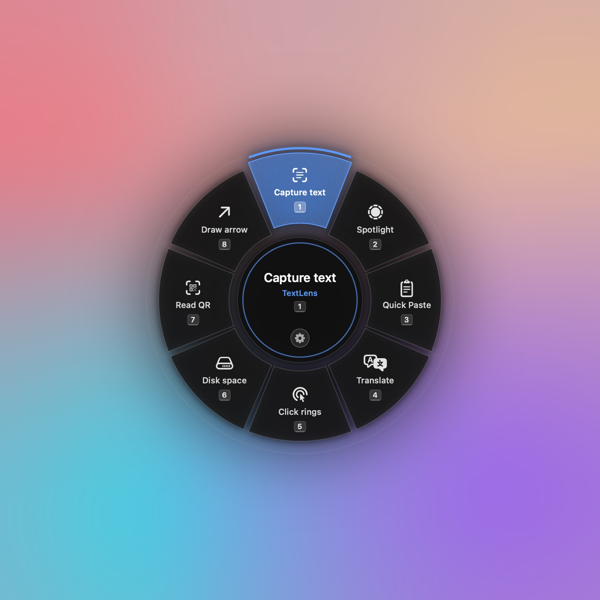
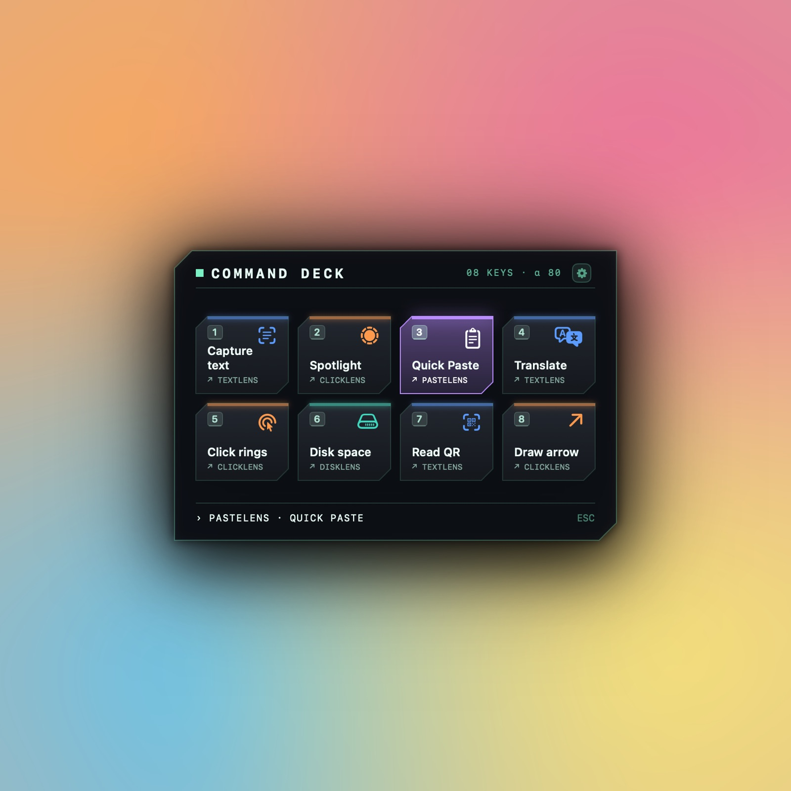
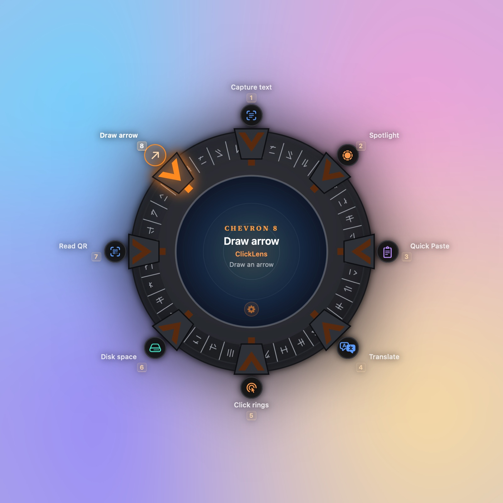
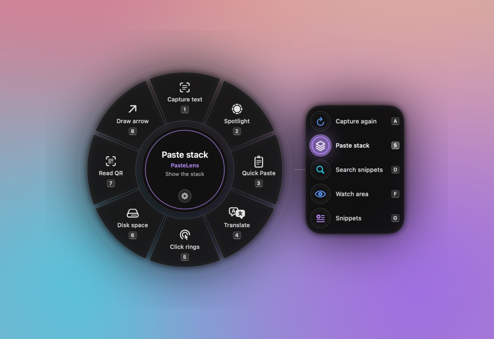
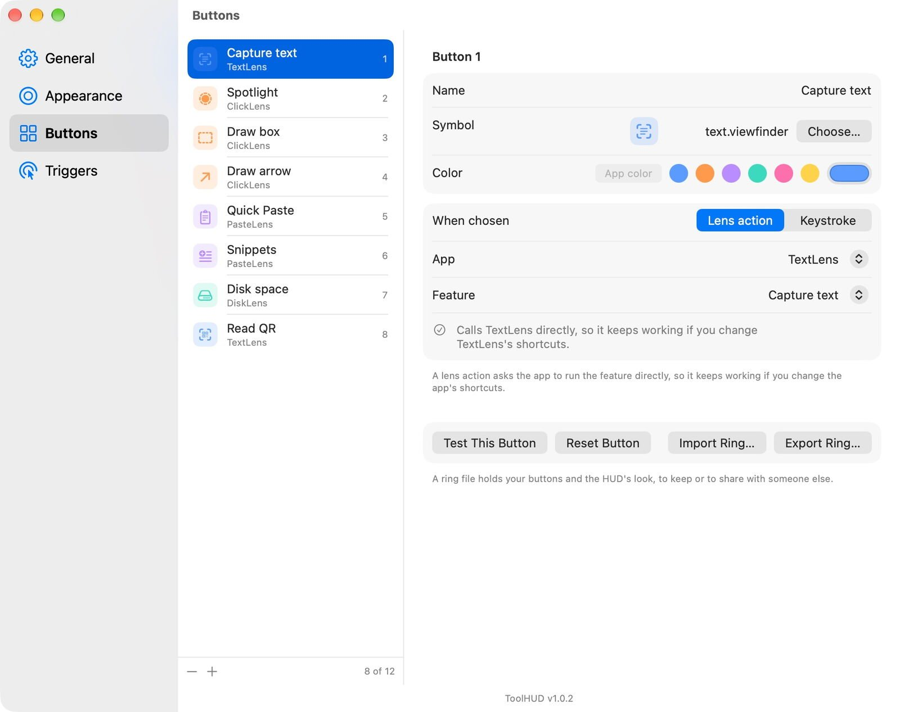
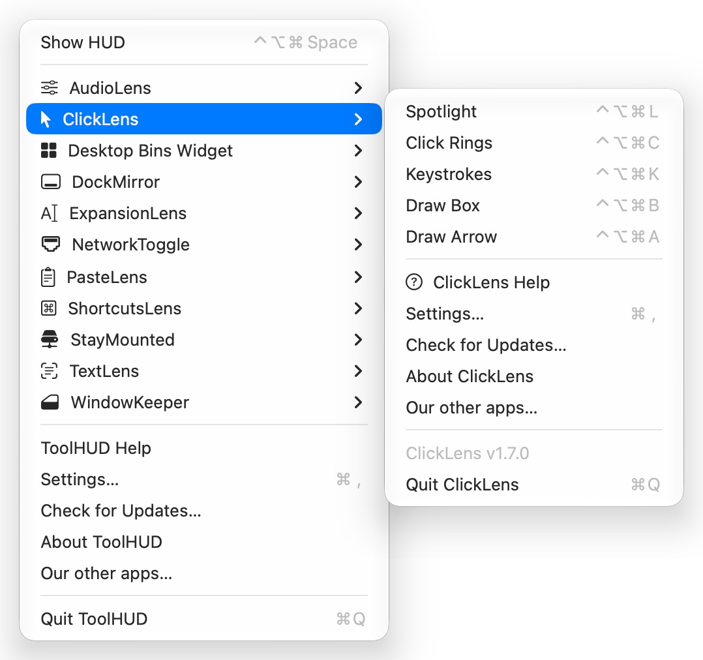
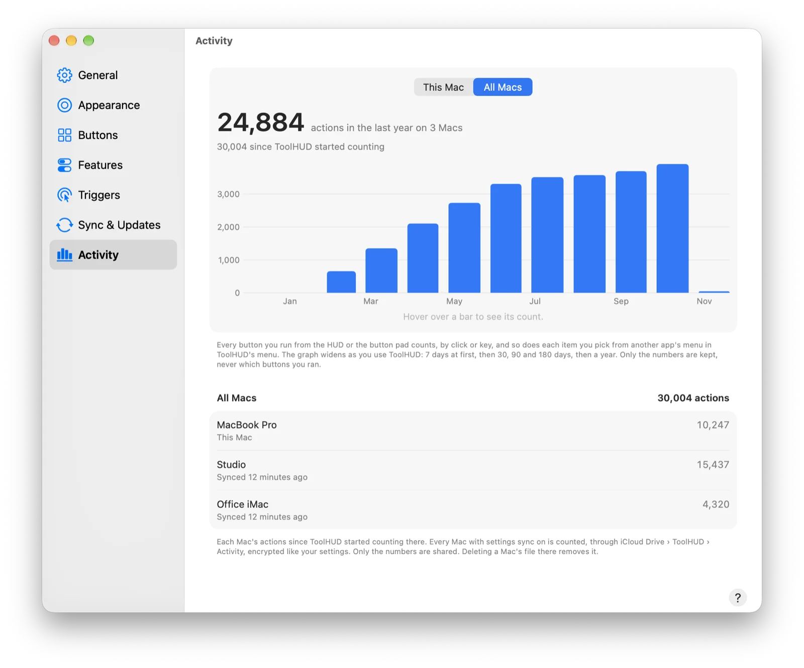

# ToolHUD

ToolHUD puts the features of your favorite apps one gesture away. Press a shortcut or click
the mouse in any app, and a ring of buttons opens around the pointer. Click a button and it
runs: capture text with TextLens, turn on ClickLens's spotlight, open PasteLens's Quick
Paste, search your ExpansionLens snippets (1.0.0 or later), or press any key combination in any app.

<p align="center"></p>

## Download

**[⬇ Download ToolHUD.dmg](https://github.com/smanke-org/ToolHUD/releases/latest/download/ToolHUD.dmg)**

1. Open the disk image and drag **ToolHUD** to **Applications**.
2. Open ToolHUD. Its icon appears in the menu bar.
3. Allow **Accessibility** when asked (System Settings › Privacy & Security › Accessibility).
   The mouse triggers and keystroke buttons need it. The keyboard shortcut and lens actions
   work without it.

Requires macOS 26 or later.

## Features

- **A ring at your pointer**: press ⌃⌥⌘Space or ⌥ + right-click in any app and a ring of 2 to 12 buttons opens around the pointer. Click a button or press its number; letting go of the shortcut or the mouse never runs anything.
- **Lens actions**: buttons run features of our other apps directly, through their URL schemes: capture text with TextLens, turn on ClickLens's spotlight, open PasteLens's Quick Paste, search ExpansionLens snippets and more. They keep working if you change those apps' shortcuts.
- **Keystrokes**: a button can press any key combination, or several in a row, in the app you were using or in an app you choose.
- **More kinds of buttons**: run a shortcut from the Shortcuts app, open a web page, file, folder or app, type or paste a piece of text, choose a menu item in any app, or run an AppleScript or shell command. A Steps button runs several of these in turn, with a wait after each.
- **Type to search**: press / in the HUD and type to find any button, any feature of your apps, any item in your apps' menus, or any shortcut.
- **Extras for power users** (Settings › Features, off until you want them): folder buttons that open a smaller ring, a different ring for each app, running the last action again from the HUD's center, app menu buttons, and green lights on buttons whose feature is on.
- **Eleven looks**: Halo, Orbit, Dial, Stargate, Red Alert, Constellation, Glass Pills, Planetary and Liquid Glass rings, or the Command Deck and Hive button hubs. Opacity, size, where it opens, a sound and a trackpad haptic are adjustable.
- **Button pad**: up to 8 more buttons beside the HUD, drawn to match its look, that run on A, S, D, F, G, H, J and K.
- **Mouse triggers**: open the HUD with ⌥ + right-click, by holding the right button, with the middle button, or with either side button.
- **More ways to open it**: double-tap ⌘, ⌥, ⌃ or ⇧, rest the pointer in a screen corner, or use the Show ToolHUD action in the Shortcuts app.
- **Shareable rings**: export your buttons, button pad and look to a `.toolhudring` file, and import one to keep or share.
- **Your apps' menus**: while ToolHUD runs, our other apps can leave the menu bar and appear as submenus of ToolHUD's menu.
- **Activity**: Settings › Activity graphs how many actions you've run, on this Mac or all your Macs. Only the numbers are kept, never which buttons you ran.
- **Encrypted sync**: your buttons, look, shortcut and triggers follow you to every Mac on the same iCloud account, end-to-end encrypted with your sync passphrase.
- **Automation**: `toolhud://show` opens the HUD (`?ring=` an app's ring or a folder), `toolhud://repeat` runs the last action again, and the Shortcuts app gets Show ToolHUD and Run ToolHUD's Last Action Again.

## Screenshots

<table>
<tr>
<td width="50%"><br><sub><b>Command Deck.</b> One of eleven looks: a panel of keycaps.</sub></td>
<td width="50%"><br><sub><b>Stargate.</b> The chevrons are the buttons; the gate opens when one locks.</sub></td>
</tr>
<tr>
<td width="50%"><br><sub><b>Button pad.</b> More buttons beside the ring, run with A to K.</sub></td>
<td width="50%"><br><sub><b>Buttons.</b> Pick an app feature or a keystroke for each button.</sub></td>
</tr>
<tr>
<td width="50%" align="center"><br><sub><b>Your apps' menus.</b> Other apps as submenus of ToolHUD's menu.</sub></td>
<td width="50%"><br><sub><b>Activity.</b> How many actions you run, on this Mac or all your Macs.</sub></td>
</tr>
</table>

## Use it

| Gesture | What it does |
|---|---|
| ⌃⌥⌘Space | Open the HUD at the pointer, then click a button. Press the shortcut again to close it. |
| ⌥ + right-click | Open the HUD from the mouse, in any app. |
| 1–9, 0 | Run button 1–10 while the HUD is open. |
| A S D F G H J K | Run the button pad, first to last. |
| ← → ↑ ↓, Tab | Move between buttons; Return runs the lit one. |
| / | Search buttons, app features, app menus and shortcuts. |
| Space, or click the center | Run the last action again (when turned on in Features). |
| Esc | Close the HUD, or go back out of a folder or the search. |
| ⚙ or , | Open Settings. Every look has a small gear; click it, or press comma. |

A button runs only when you click right on it (a few points' margin forgives a near miss)
or press its number. Letting go of the shortcut or the mouse button never runs anything, so
the HUD stays open until you choose.

The shortcut and the mouse trigger can be changed in Settings › Triggers. The mouse can open the HUD with ⌥ + right-click, by holding the right button (a quick
right-click still opens the app's own menu), with the middle button, or with either side button.

## Buttons

Settings › Buttons holds 2 to 12 buttons. Each has a name, an SF Symbol, a color (or its
app's color) and one of two actions, chosen per button:

- **Lens action**: asks one of our apps to run a feature directly, through its URL scheme
  (`textlens://capture`, `pastelens://quickpaste`). It keeps working if you change that app's
  shortcuts. ToolHUD lists the installed lens apps and their features by name. Until an app
  supports lens actions, ToolHUD presses the feature's default shortcut instead. An app that
  isn't installed links to its page on stevemanke.com, or to its GitHub releases.
- **Keystroke**: presses any key combination, either in the app you were using (the HUD never
  takes focus) or in an app you choose, which ToolHUD brings forward first. Turn on the
  modifiers to hold (⌘ ⌥ ⌃ ⇧) and type the key, or several keys to press one after another
  with the same modifiers (⌘K then ⌘S). Return, Tab, the arrows, F-keys and the like are in
  the Special Keys menu.

- **Shortcut**: runs a shortcut from the Shortcuts app.
- **Open**: opens a web address, or a file, folder or app you choose.
- **Type text**: types the text into the app you were using, or pastes it and puts your
  clipboard back afterwards (marked transient, so clipboard managers skip it).
- **Menu item**: chooses a menu item such as `File > Export…` in the app you were using or one
  you pick, through Accessibility. Choose… reads a running app's menus so you can pick one.
- **Script**: runs an AppleScript or a shell command (`zsh -l`) in the background, and says so
  if it fails.
- **Steps**: up to 12 of the kinds above, run in turn, each followed by a wait you set.
- **Folder** and **App menu**: open a smaller ring of up to 12 buttons, or show one of our
  apps' menus at the pointer. Each is turned on in Settings › Features.

Keystrokes, typed text and menu items sent to a particular app wait until that app is really
in front, and send nothing if it doesn't come forward.

Rings can be exported to a `.toolhudring` file and imported again, to keep or to share. A
ring file includes the button pad when it's on.

## Features

Settings › Features holds the extras. Type to search starts on; the rest start off, so the HUD
stays simple until you want more:

- **Type to search**: press / with the HUD open. ↑ ↓ choose, Return runs, Esc goes back.
- **Run the last action again**: point at the middle of the HUD to see what ran last, then
  click it or press Space.
- **Folder buttons**: a button opens a smaller ring in the HUD's place; Esc or Delete comes
  back out.
- **A different ring for each app**: + at the top of Buttons adds an app, starting from a copy
  of your usual buttons. That app gets its own ring and pad while it's in front.
- **App menu buttons**: show one of our apps' menus (the one gathered into ToolHUD's menu) at
  the pointer.
- **Show which features are on**: buttons for on/off features (ClickLens's spotlight,
  ExpansionLens, NetworkToggle's Wi-Fi, AudioLens's mute and others) get a green light while
  they're on. Apps report it with a distributed notification; the shared code is in
  `Shared/ToolHUDFeatureStates.swift`.

### For our other apps

Any app can offer lens actions by registering a URL scheme and listing its features in its
Info.plist. ToolHUD then shows them without an update of its own:

```xml
<key>ToolHUDActions</key>
<array>
    <dict>
        <key>id</key><string>capture</string>        <!-- runs scheme://capture -->
        <key>title</key><string>Capture text</string>
        <key>shortTitle</key><string>Capture</string> <!-- optional: the button's name -->
        <key>symbol</key><string>text.viewfinder</string>
        <key>activates</key><false/>                  <!-- optional: bring the app forward -->
    </dict>
</array>
```

ToolHUD adds `?source=toolhud` to every URL it opens.

## Looks

Settings › Appearance offers eleven looks, each drawn live in Settings, with a large preview of the one you choose:

- **Rings**: Halo (translucent slices), Orbit (round buttons that spring out), Dial (a rotary
  bezel), Stargate (the chevrons are the buttons, and the gate opens when one locks), Red Alert
  (crimson blades with hazard stripes), Constellation (stars joined by lines), Glass Pills
  (labeled pills), Planetary (planets that stop drifting when you aim) and Liquid Glass (clear
  glass buttons that pick up your wallpaper and follow Light and Dark).
- **Panels**: Command Deck (a panel of keycaps) and Hive (honeycomb cells).

**Button pad:** for more buttons than the ring holds, add up to 8 buttons beside the HUD,
drawn to match its look (coins for the Halo, keycaps for the Command Deck, comb cells for the
Hive, moons for Planetary and so on): a column on the left or right, or a row above or below.
Its buttons have their own list under Pad in Settings › Buttons and run on A, S, D, F, G, H,
J and K.

Opacity, size (small, medium, large), where it opens (pointer or screen center), a sound and a
trackpad haptic are adjustable.

## Your apps' menus

While ToolHUD runs, our other apps can leave the menu bar and live in ToolHUD's menu instead:
each becomes a submenu under ToolHUD's icon, with the same items as its own menu. Apps whose
icon opens a panel (NetworkToggle, StayMounted, DiskLens, AudioLens) list their main actions
and open the full panel from there. Turn it off with "Gather my other apps' menus here" in
Settings › General, or keep one app out with the checkbox in its own Settings. If ToolHUD
quits, the icons come back right away.

## Sync

With "Sync settings with your other Macs" on (Settings › Sync & Updates), your buttons, look,
shortcut and triggers follow you to every Mac signed in to the same iCloud account. They go
through iCloud Drive, end-to-end encrypted: everything is sealed with AES-256-GCM on your Mac
under a random key, and that key is stored in iCloud only wrapped by your sync passphrase
(PBKDF2-SHA256, 600,000 rounds). The passphrase never leaves your Macs, so neither Apple nor
the developer can read your settings.

## Privacy

ToolHUD has no account, analytics or tracking. The only connection it makes on its own is to
GitHub, to check for updates. Accessibility access is used only to watch the mouse button you
chose as a trigger and the modifier key you double-tap, and to press the keys, type the text
and choose the menu items your buttons send.

## Updates

ToolHUD checks for new versions once a day, or as often as you choose in Settings (a number of hours, days, weeks or months). In Settings › Sync & Updates you choose whether it
installs them automatically when you're not using it, asks first, or doesn't check.

## Automation

| URL | What it does |
|---|---|
| `toolhud://show` | Open the HUD in the middle of the screen |
| `toolhud://show?ring=Safari` | Open an app's ring, or a folder button, by name |
| `toolhud://repeat` | Run the last action again |
| `toolhud://settings` | Open Settings |

The Shortcuts app also offers **Show ToolHUD** (with an optional ring or folder name) and
**Run ToolHUD's Last Action Again**. Besides the keyboard shortcut and mouse trigger, the HUD
can open on a double-tap of ⌘, ⌥, ⌃ or ⇧, or when the pointer rests in a screen corner
(Settings › Triggers).

## Build from source

```bash
Tools/make_icns.sh   # once: draws the icon into Resources/AppIcon.icns
./build_app.sh   # universal binary, Developer ID signed
./install.sh     # copies to /Applications in place and launches
swift test       # ToolHUDKit unit tests
./release.sh 1.0.1
```

The disk image's window layout ships as `Resources/dmg/DS_Store`. Capture it once with
`Tools/capture_dmg_layout.sh .build/app/ToolHUD.app ToolHUD Resources/dmg/DS_Store`.

## License

© 2026 Steve Manke. All rights reserved.
